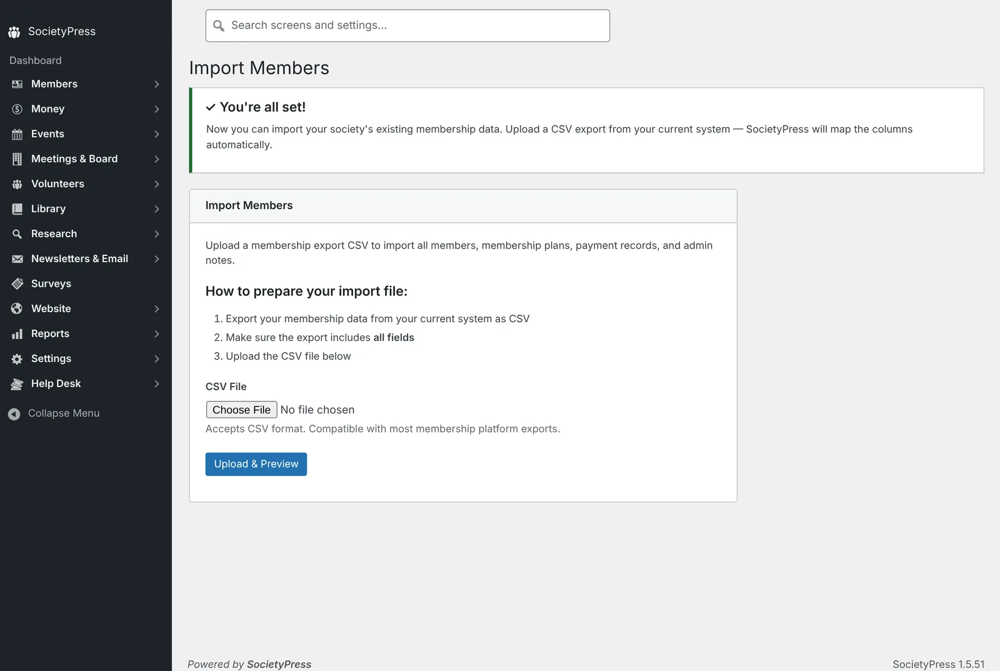
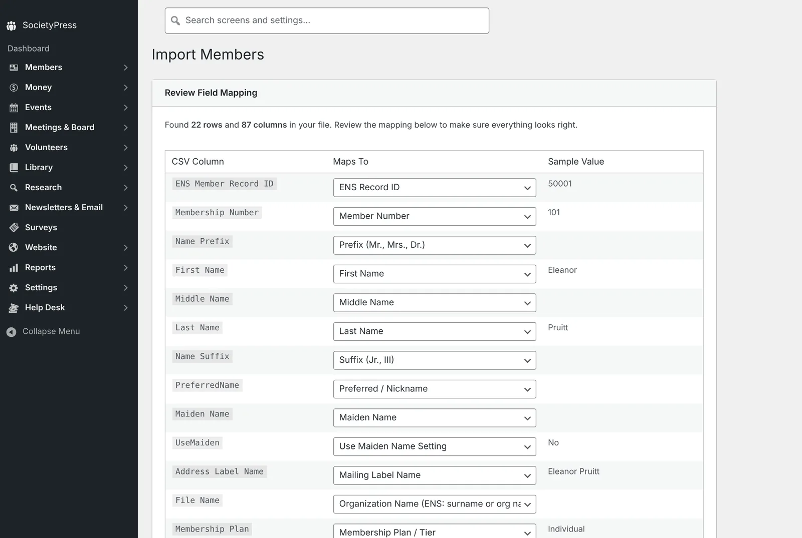
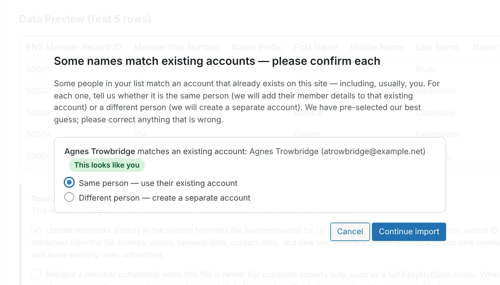
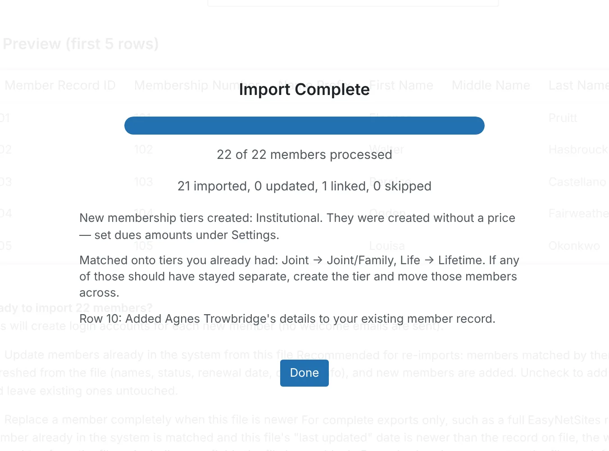
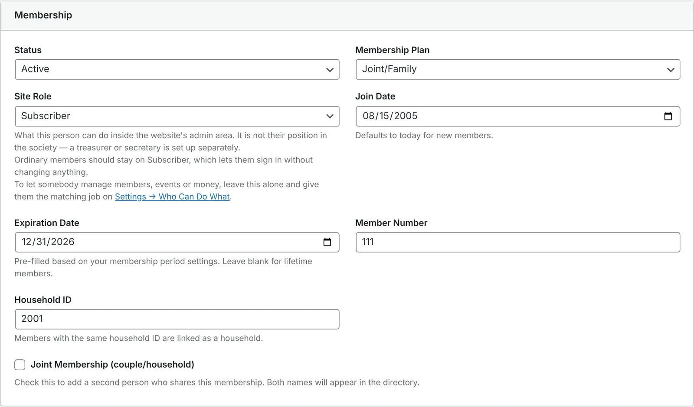
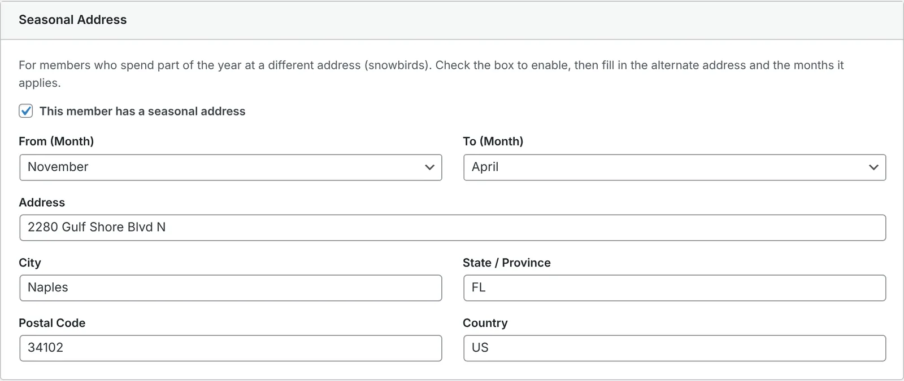
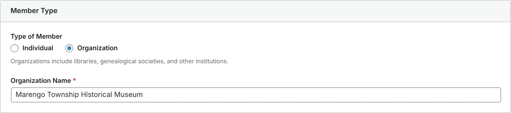
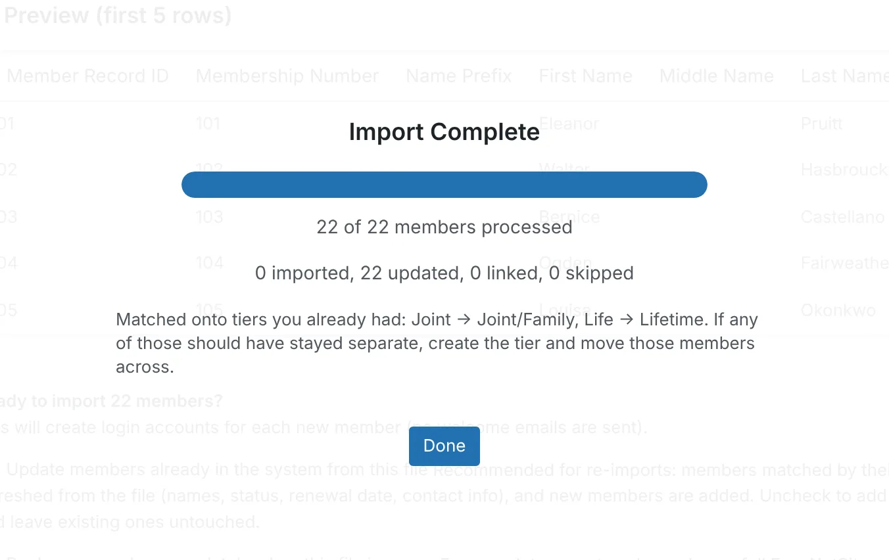

# A migration, start to finish

The [migration guide](ENS-MIGRATION-GUIDE.md) tells you what to do. This
page shows you what actually happens when somebody does it — one complete
ENS import, run on a clean SocietyPress 1.5.51 install, with the real
numbers and every screen along the way.

Nothing here is a mockup. Every figure and every screenshot below came out
of an actual import.

---

## The society

Cedar County Genealogical Society is invented, and so is every person in
its member file. It exists so this walkthrough can show you real behaviour
without publishing anybody's real membership list.

Its ENS export holds **22 members in 87 columns** — the standard ENS
member export plus the dues and payment block that societies collecting
money through ENS will also have. Twenty-two is small on purpose. It is
big enough to contain every awkward case and small enough that you can
check the result by eye, which is exactly what you want the first time you
try this.

The file was built to be difficult in the ways real society files are
difficult:

| What's in it | Why it's there |
|---|---|
| 10 ordinary individual members | The easy case, and most of any real file |
| 3 married couples, 6 rows | Each couple shares one **Membership Tie ID** — this is what makes them one membership rather than two |
| 1 snowbird | Winters in Florida, so the row carries a full seasonal address and the dates it applies |
| 1 life member | Paid once in 2004, no expiration date, joined 1994 |
| 1 lapsed member | Stopped renewing in 2025 |
| 1 deceased member | Marked deceased, family asked that the surname file stay open |
| 2 institutional members | A library and a museum, each with a named contact person |

One of the ten individuals is Agnes Trowbridge, the society's webmaster —
the person doing the import. That matters, and it is the first thing you
will run into.

---

## Step 1: Add yourself

Open **Members → Import** on a fresh site and SocietyPress stops you before
you upload anything: it asks you to add yourself as the society's first
member. That links the account you signed in with to a member record, so
you appear in the directory and can use My Account like everybody else.

Use the **same email address the society has on file for you** — the one
in your ENS record. It is how the import will recognise you in a moment.
If your WordPress account was set up with a different address, the import
falls back to matching your name, but the email is the surer of the two.

With that done, the import screen opens.



---

## Step 2: Upload and check the mapping

Upload the CSV exactly as ENS gave it to you. SocietyPress reads the
header row and matches every column it recognises to where it belongs.



All 87 columns were matched without help. The left column is what your
file calls it, the middle is where it is going, and the right is the value
from the first row, so you can see at a glance that First Name really
contains first names. If one of your columns has been given a name ENS
never used, this is where you point it at the right place.

---

## Step 3: Confirm it's you

Click **Run Import** and, before anything is written, SocietyPress shows
you any row that looks like somebody who already has an account on the
site. On a fresh install that is you, and only you:



"Same person" is already selected. Leave it. Your row from the file is
then added to the member record you made in Step 1 — your member number,
join date, plan and payment history — instead of creating a second Agnes
Trowbridge beside the first. Your password and sign-in stay exactly as
they are.

---

## What happened

```
22 of 22 members processed
21 imported    0 updated    1 linked    0 skipped
```



Twenty-one members were created and one — you — was linked. Nothing was
skipped and nothing errored. The summary also says what it did to your
membership plans, because that is a decision it made on your behalf:

- **Created:** Institutional. SocietyPress has no plan by that name, so it
  made one. It has no price yet; set the dues under Settings.
- **Matched:** Joint onto Joint/Family, Life onto Lifetime. SocietyPress
  ships with those five plans already, and "Joint" and "Life" are the same
  plans under shorter names, so the members joined the existing ones
  rather than creating near-duplicates beside them.

Here is what the site looked like afterward.

; the deceased member is Inactive.")

**Statuses sorted themselves out.** 20 active, 1 inactive, 1 lapsed —
matching the file exactly. The deceased member came across marked
deceased and set inactive, with the administrative note preserved.

**Plans landed where they should.** 13 Individual, 6 Joint/Family (the
three couples), 1 Lifetime, 2 Institutional.

**The couples became couples.** All three pairs arrived sharing a
household, matched on their Membership Tie ID:

```
2001 — Harold Whitmore + Greta Whitmore
2002 — Silas Duplantier + Ramona Duplantier
2003 — Theodore Ashby + Winifred Ashby
```



This is the single most important thing to check after your own import. If
your couples arrive as six unrelated people instead of three memberships,
your Tie ID column didn't come across, and it is far easier to fix that now
than after a renewal season.

The Duplantiers share one email address in the file, as many couples do.
WordPress needs every account to have its own, so Ramona's sign-in became
`duplantiers+sp2@example.net` — a form of the address that most mail
services deliver to the same inbox.

**The seasonal address survived intact**, including the dates it applies —
November 1 through April 15:



That means the Quarterly gets mailed to Florida in the winter without
anybody having to remember to change it. The form only asks for months,
but the day your ENS record gives is kept, and saving the member — or the
member saving their own address in My Account — doesn't lose it.

**Both institutions are organizations**, each with its contact person
attached:



---

## Institutions: how SocietyPress tells them apart

Institutional members — libraries, museums, partner societies — usually
appear in an ENS export as a contact person's name with the institution's
name in the **File Name** column. The trouble is that in most ENS exports,
File Name holds the member's own surname for ordinary individuals too. If
SocietyPress treated every populated File Name as an institution, it would
turn your entire membership into organizations.

So it also looks at the **Membership Type** column, and files the row as an
organization when that says so: "Organization", "Institutional",
"Corporate", "Company", "Non-Profit", "Agency" and a few other ordinary
ways of putting it. The library in this file says `Organization` and the
museum says `Institutional`; both were filed correctly.

The list is deliberately conservative. "Library", "Museum", "Society" and
"Church" are *not* treated as organizations, because a society might just
as easily use one of those words for an individual tier — and turning your
whole membership into organizations would be a much worse mistake than the
one being avoided.

If your society uses a word of its own, the import files that row as an
individual, and the summary tells you so: how many rows had an
organization name it didn't use, and which Membership Type values it saw.
Correct those rows in the spreadsheet and import again.

---

## Running it twice is safe

This is the part most people are afraid of, so it is worth stating plainly:
**importing the same file a second time does not duplicate anybody.**

The same file was imported again, unchanged:

```
22 of 22 members processed
0 imported    22 updated    0 linked    0 skipped
member count: 22 (unchanged)
```



Twenty-two updates, zero new records, same total — and the payment history
was not recorded a second time. SocietyPress matches each incoming row
against members it already has using the **ENS Member Record ID** column,
which is stable across exports. That is what makes a second import an
update rather than a duplication. Your own record is included: the first
import gave it your ENS Record ID, so the second recognised you without
asking.

This matters more than it sounds. It means you can import, discover
something wrong, fix it in the spreadsheet, and import again — as many
times as you need — without cleaning up after yourself. It also means you
can do a trial import weeks before your real cutover, then re-import the
current file on the day, and only the changes come across.

The one thing that breaks this: if your export doesn't include the ENS
Member Record ID column, SocietyPress has nothing stable to match on. Check
for it before your first import.

---

## What to check after your own import

In this order, because each one is cheaper to fix than the one after it:

1. **Total count.** Does the number of members match the number of rows in
   your file? If not, look at the skipped count and the messages under it.
2. **You, once.** Search the member list for your own name. There should be
   one of you, with your ENS member number on it.
3. **Your couples.** Pick three you know and confirm each is one membership
   with two people, not two memberships.
4. **Your plans.** Read what the summary said it created and matched. Set
   prices on any plan it created.
5. **Your institutional members.** Confirm the institution's name appears,
   not just the contact person's.
6. **A seasonal address**, if you have any. Confirm the months came across
   along with the address.

If something is wrong, fix the spreadsheet and import again. That's what
the re-import safety is for.

---

## What earlier runs turned up

This walkthrough was first run in August 2026, and running it end to end
is how three problems were found. They are fixed, and they are listed here
because each one explains something the import now does on purpose.

- **Duplicate plans (fixed in 1.5.5).** Plans called "Joint" and "Life"
  used to be created alongside the built-in Joint/Family and Lifetime,
  leaving eight plans where four were meant. That is why the summary now
  says what it matched.
- **Institutions filed as individuals (fixed in 1.5.4).** Only the exact
  word "Organization" used to count, so the museum lost its name. That is
  why the wider list above exists, and why the summary reports values it
  didn't recognise rather than staying quiet.
- **The webmaster imported twice, and lost snowbird dates (fixed in
  1.5.51).** Adding yourself first used to make you a member the
  confirmation in Step 3 never asked about, so your own row arrived as a
  second copy of you. Separately, the member form couldn't display a
  seasonal date it hadn't written itself, so editing an imported snowbird
  erased their dates.

---

## Where this was run

On a throwaway WordPress install, not on a live site and not on the public
demo. That is the recommended way to do your own first pass: a scratch
install, a real file, and no consequences. When you are satisfied the
result is right, do it again on the site you actually intend to keep.

The demo site at [demo.getsocietypress.org](https://demo.getsocietypress.org)
carries a different dataset and is not part of this walkthrough. The
Cedar County file can be rebuilt with
`scripts/generate-ens-walkthrough-fixture.py` in the SocietyPress
repository, so anybody can run the same import and check these numbers.
